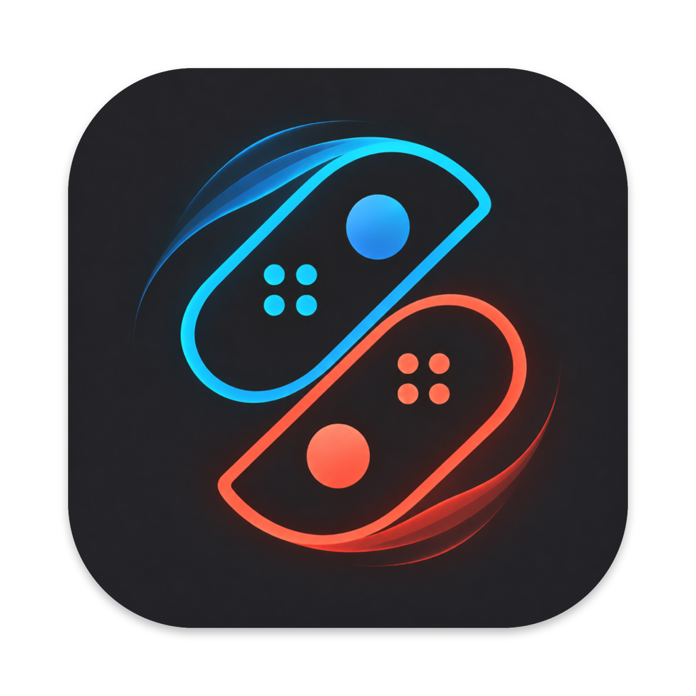
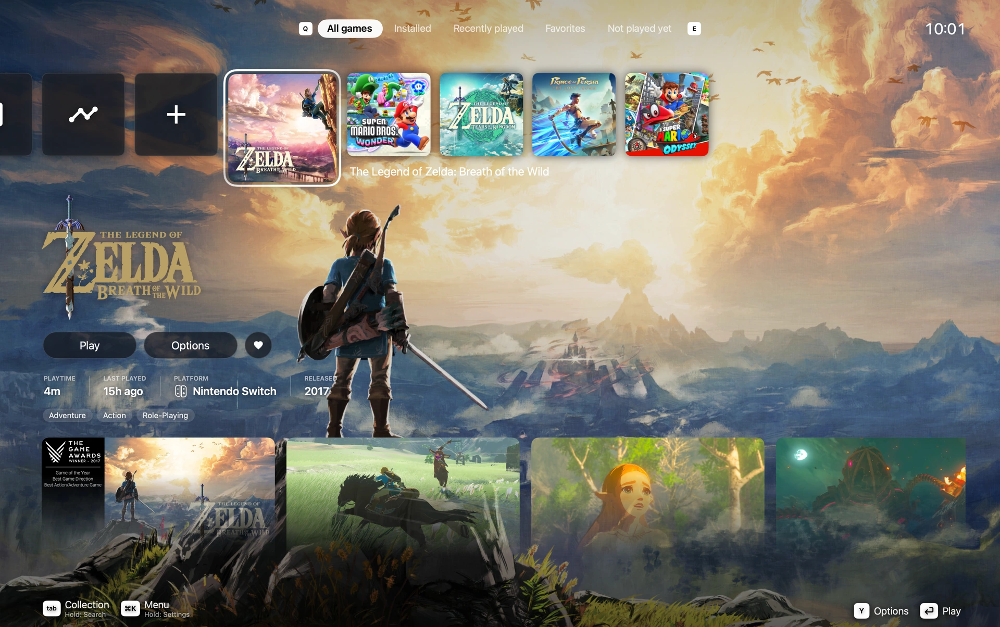
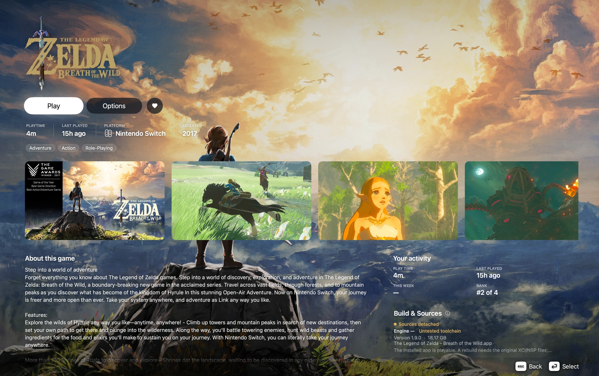
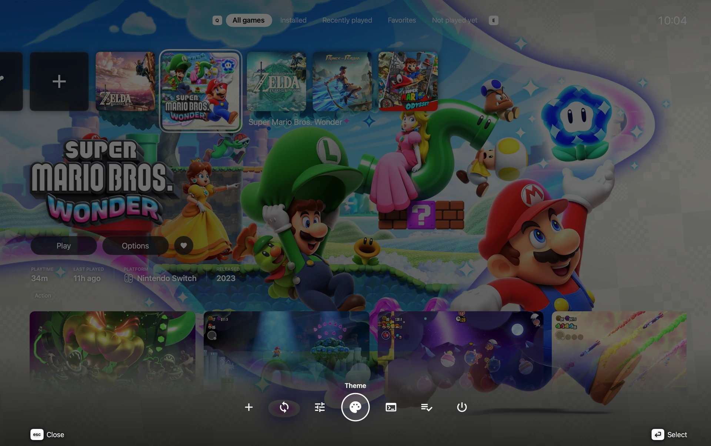
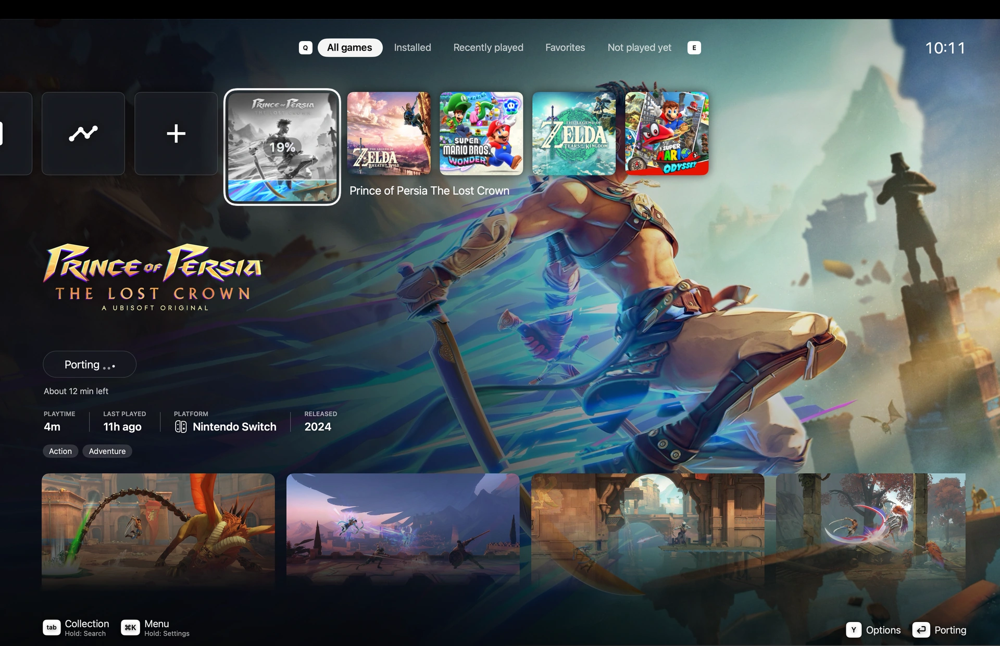
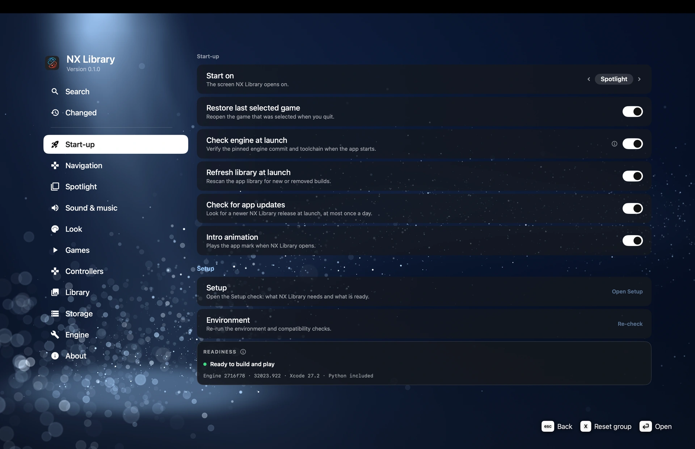
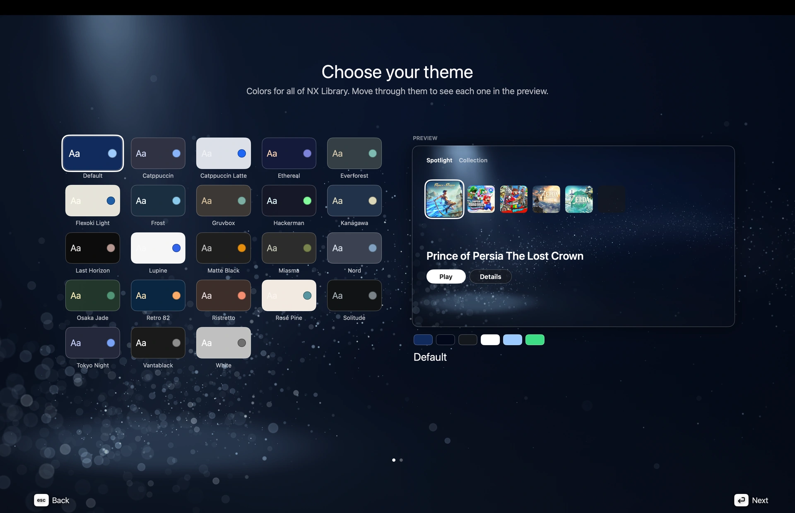
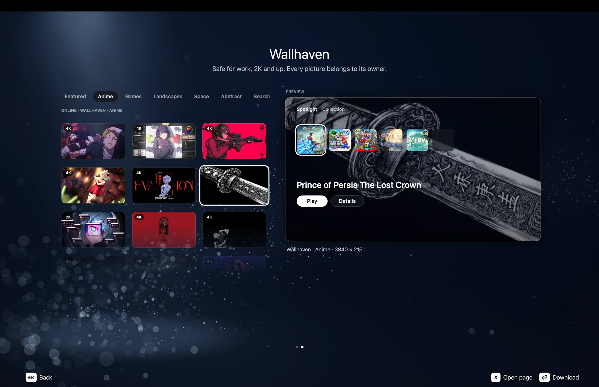
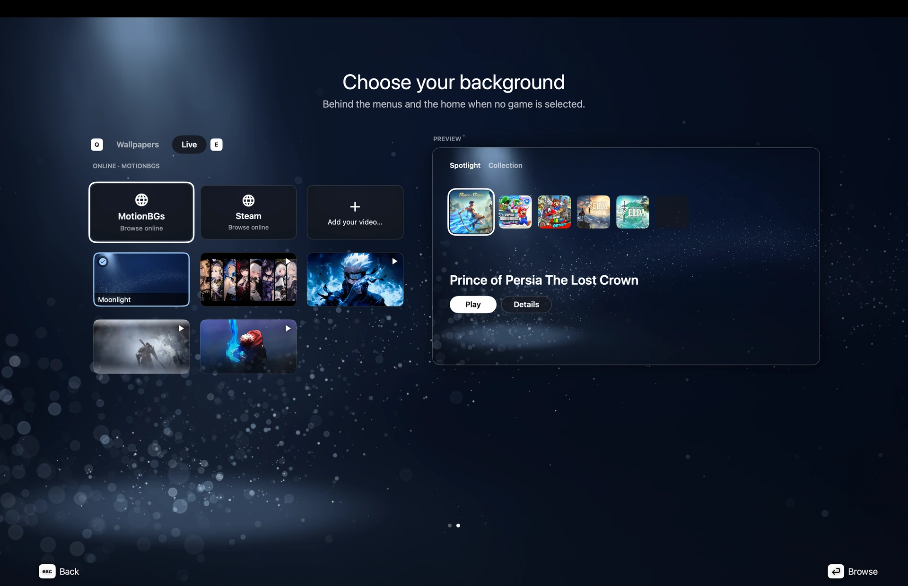

<h1 align="center">
  
  NX Library
</h1>

<strong>A home for your games on Mac.</strong>

  Organise your library, build your own Switch dumps with nxnative, 
  and launch the resulting Mac apps from one place.

  
  
  
  

  <a href="https://github.com/Bium23/NxLibrary/releases/latest">Download</a> ·
  <a href="#getting-started">Get started</a> ·
  <a href="#using-nx-library">User guide</a> ·
  <a href="#troubleshooting">Troubleshooting</a> ·
  <a href="CHANGELOG.md">Changelog</a> ·
  <a href="#next-steps">Next steps</a> ·
  <a href="docs/development.md">Development</a>

<!-- NX-DEMO:START
Insert the final GitHub-hosted video attachment here, below the introduction.
Use the real recording; keep this slot hidden until the video is available.
NX-DEMO:END -->

<!-- NX-SCREENSHOTS:START -->

<strong>Your library, together.</strong> Games, artwork and activity in Spotlight.

<!-- NX-SCREENSHOTS:END -->

## Overview

NX Library is an independent SwiftUI frontend for the external [nxnative](https://github.com/seedds/nxnative) toolchain. It brings your installed game apps, local build workflow and game options into a modern Mac-native library inspired by [Selene](https://github.com/mattxslv/Selene).

| Area | What you can do |
|---|---|
| **Library** | Browse Spotlight and Collection, search, favourite, hide and reorder games. |
| **Local builds** | Select your own sources, review updates and DLC, follow progress and retry a failed installation. |
| **Game options** | Keep each title's launch settings, artwork and metadata together. |
| **Saves** | Back up local progress, preview imports and restore a previous copy. |
| **Cheats** | Import matching cheat files and choose what is enabled for the next launch. |
| **Personalisation** | Choose palettes, wallpapers, live backgrounds, interface sounds and controller prompts. |

Game files, keys and firmware are not provided. See [Legal and third-party notices](#legal-and-third-party-notices).

### Project status

**0.1.3.3 alpha.** Download the packaged app from [Releases](https://github.com/Bium23/NxLibrary/releases/latest), or [build it from source](#building-from-source).

Automated checks cover the application code, publication inputs, compilation and development-app packaging. They do not certify game compatibility. Changes are recorded in the [changelog](CHANGELOG.md), and the current checks are available under [Actions](https://github.com/Bium23/NxLibrary/actions/workflows/ci.yml).

The engine is pinned to `b64a5ff0`, with audio, memory and renderer fixes, updated game profiles and shader-build improvements, using Xcode 27.2 / Metal 32023.922. See the [engine upgrade notes](docs/upstream-upgrades/2026-11-03-65501fbb-b64a5ff0-review.md).

## Getting started

### Requirements

| Requirement | Details |
|---|---|
| **Mac** | Apple silicon, macOS 13 or later. |
| **Xcode** | 27.2 or later, with the Metal compiler certified for the pinned engine. |
| **.NET** | .NET 10 SDK, used by the engine's extractor. |
| **Engine** | nxnative at the pinned commit. Setup can prepare the checkout; an existing folder can be chosen in **Settings → Engine**. |
| **Your files** | Your own supported game sources and keys, with the rights and permissions needed to use them. |

A packaged app includes Python and its required packages, `zstd` and `glslangValidator`. Homebrew is used to prepare that runtime during development; it is not needed to use a packaged copy. A source build without the bundled runtime uses the engine's virtual environment and tools on `PATH`.

### Building from source

With the [development prerequisites](docs/development.md#development-prerequisites) installed:

~~~bash
git clone https://github.com/Bium23/NxLibrary.git
cd NxLibrary

bash scripts/bundle_runtime.sh
bash scripts/build_app.sh
open "$HOME/Applications/NXLibrary.app"
~~~

Run `bundle_runtime.sh` once, and again when `runtime.lock` changes. `build_app.sh` prepares, signs and verifies the app before installing it atomically in `~/Applications`.

Build options, runtime dependencies, debug builds and release packaging are documented in the [development guide](docs/development.md).

### Installing a packaged release

1. Download the DMG from [Releases](https://github.com/Bium23/NxLibrary/releases/latest).
2. Open it and drag **NX Library** to Applications.
3. Open the app and complete Setup.

The current alpha is ad-hoc signed and not notarised. If macOS blocks first opening, use **System Settings → Privacy & Security → Open Anyway** only for a copy you built or obtained from a source you trust.

Packaged releases check this repository for app updates; no GitHub account is needed. Choose **Update** to download, verify, install and reopen NX Library while keeping your library and preferences. Automatic checks run at most once every 24 hours; **NX Library → Check for Updates…** in the macOS menu bar and **Settings → About → Check now** check immediately. Both open the same app-style dialog, with scrollable release notes and a visible result even when no update is available. Updates wait while a build, a running game or a save operation requires the app. Development builds can check public releases manually but never replace themselves.

### First-run setup

Setup has two steps, **Get ready** and **Your games**.

**Get ready** shows the engine, build tools and keys. **Install all** handles the supported steps: the engine checkout, the certified Metal compiler and the official .NET installer. Xcode itself comes from the App Store; its licence and any system prompts remain your responsibility. Choose **Continue** to proceed; incomplete build requirements can be finished later, and existing game apps remain playable.

**Your games** shows **Game apps**: where to keep existing nxnative games (`.app`) and install new builds. It checks the selected folder before reporting an empty library. Use **Change** to choose another folder, **Choose game file** for NSP, XCI, NSZ or XCZ, or **Choose a folder instead** for a source folder, including supported extracted inputs. A single detected title opens the existing build review; multiple titles require a choice. Selecting sources never starts a build by itself. Cancelling the picker stays on this page.

If games are found, **Open library** takes you to them. **Skip for now** enters the launcher without adding a game and is remembered: the welcome flow does not return automatically just because the library is empty. Add games later from Spotlight's Add Game card or Collection. An interrupted first setup resumes on its current step.

The default Game apps folder is `~/Applications`; first use can prepare this default without an extra picker. Remembered or custom unavailable folders are never recreated automatically. Changing folders does not move installed apps, and a rebuild updates an existing app in its current location. A read-only folder still allows discovery and Play; installing new builds needs write access.

Discovery includes subfolders of Game apps. It stays inside the chosen folders, skips app contents and limits how far it searches. Search limits and unreadable folders are explained beside **Settings → Library → Scan game apps**, without interrupting launch. Existing library entries are kept. If several builds of a title are found, the registered app is retained while it exists; a newly discovered title uses the most recently modified build.

**Game files** is a separate optional folder preference in **Settings → Library**. Selecting individual files for a porting does not replace that preference or scan their siblings. Both folder choices can be changed in Settings later.

Import your `prod.keys` when prompted. NX Library keeps a private copy with mode `0600` and leaves the original file unchanged. Key values are not displayed or logged.

Reopen both setup steps from **Settings → Start-up → Open Setup** whenever needed; this keeps your library and completion state. NX Library never runs `sudo`, accepts the Xcode licence for you or changes `xcode-select`.

Already have a built nxnative game app? Use **Settings → Library → Scan game apps → Scan**. The same action finds existing builds and refreshes the library. Play remains available without the original sources; rebuilding requires attaching them again.

If an installed app is moved or removed, its library entry stays with a blurred, locked tile and **App not found**. Restore it to its folder or change **Game apps**, then refresh the library. NX Library does not search elsewhere for it. Missing build inputs show **Game files not found** when there is no app to play. An existing app still plays when its source files are missing; only rebuilding is unavailable. To reconnect a game's moved inputs, use **Game Options → Edit details → Attach sources…**.

## Using NX Library

### Your library

**Spotlight** places your games in a row of square tiles, with Play, Options and Favourite beside the selected title. Scroll down for descriptions, screenshots, activity and build information. **Collection** offers a cover-based view.

<strong>A closer look at each game.</strong> Artwork, play history and build details in one place.

Use **Find a game** for search, **Game Options** for title-specific actions, and the menu for themes, Settings and running-game controls. Hidden games can be restored under **Settings → Games → Hidden games**.

<strong>Quick access.</strong> Open the menu without leaving your library.

### Add or rebuild a game

1. Open **Add game** and choose or drop a supported file or folder.
2. Review the detected base game, update and DLC. Supported source formats are NSP, XCI, NSZ and XCZ.
3. Check the destination, disk estimate and game options.
4. Choose **Add and port** to build, or **Add to library only** to keep the entry for later.

For a title already in the library, Review opens with that game's saved options and offers **Rebuild** or **Save changes**.

Sources stay in place; staged workspaces use symbolic links. New game apps install in the chosen **Game apps** folder. Builds run on the drive the app goes to: with the folder on an external APFS or Mac OS Extended drive, the extracted game, shader cache and new app stay on that drive in a hidden `.nxlibrary-build` folder, so the Mac's disk needs no space for the build and the app is moved into place, not copied. On an exFAT drive or a network share builds keep using the Mac's disk: exFAT keeps Mac file attributes in separate `._` files, which break a built app's signature. Review shows the actual destination, including any filename needed to avoid an unrelated app. Build stages, progress, estimated time and a live log remain available while the operation runs. The first build of a game after an engine update can first move its shader cache into the engine's new format: that shows **Updating shader cache** instead of an ETA and takes longer on a large cache or an external drive. Closing the porting screen leaves the operation running; cancellation is a separate action.

A rebuild of a running game waits to replace its app until it closes. If compilation finishes but installation fails, **Retry** installs the preserved result without compiling again. If the destination folder disconnects, reconnect it before retrying: the ready build keeps its original destination. A library refresh preserves pending installations and failure information.

<strong>Follow the build.</strong> Keep track of porting progress from Spotlight.

### Know which settings apply

| Where | Scope | When it applies |
|---|---|---|
| **Settings → Games → New games** | Starting values for titles added later. | When a new title is added. Existing titles keep their choices. |
| **Game Options → Next launch** | The selected game. | Its next launch. |
| **Game Options → Use new game defaults** | Copies the current defaults into that game once. | Its next launch. |
| **Add game → Review** | The title being added or rebuilt. | That operation, including its saved language. |
| **Settings → Games → Cloud saves** | Library-wide preference, subject to advanced game configuration overrides. | Reapplied before each launch, including when Off. |
| **Settings → Look** | The library's presentation. | The app interface; game artwork and launch-screen style have their own controls. |

Options include fullscreen, FPS target, docked mode, language, rumble, render scale, MetalFX upscaling and Metal HUD. **MetalFX upscaling** enlarges the finished picture, HUD included, to your window or screen. **Game's upscaler**, offered only by games that upscale their own picture inside the frame (such as Donkey Kong Bananza), keeps the game's own upscaler or swaps it for MetalFX's, which takes much less GPU time; both can be on. Some controls depend on the installed build's capabilities. A control being available does not guarantee that every game supports its effect.

Settings includes **Search** and **Changed**. Group resets retain the cloud-sync choice and selected sources folder. Descriptions explain the scope; information buttons provide additional detail.

<strong>Settings by area.</strong> Find library, appearance, controller and start-up preferences.

### Saves: back up, import, restore

Open **Game Options → Saves**, directly below Cheats. Keep the game closed during backup, import or restore.

| Button | What it does |
|---|---|
| **Open folder** | Opens the current local save in Finder. |
| **Back up now** | Creates a dated, verified copy of account and device saves. |
| **Save type** | Selects the import destination. **User save** is the usual choice; **Device save** is for a separate device save. |
| **Import save…** | Previews an exported save folder or a dated NX Library backup before replacing anything. |
| **Refresh** | Reads save and backup information again. If recovery is needed, offers **Retry recovery**. |
| **Backup folder** | Opens this game's backups in Finder. The row shows the latest backup's date and time. |

**To import:** choose the folder, review the centred **From → To** preview, then confirm. NX Library backs up existing progress first and verifies the result. A successful import shows **Imported successfully**, which disappears after three seconds.

For Ryujinx, choose the numbered game folder under `bis/user/save/`. A folder selected inside that tree is recognised too; NX Library checks its title metadata and imports the complete committed save, including all slots. For other exports, choose the folder containing the complete save.

**To restore:** choose a dated backup folder through **Import save…**. A restore reinstates both recorded destinations, including whether either one was absent. An ordinary import replaces the selected destination.

**Cloud sync and backups have different purposes.** Cloud sync can replace local files, so import and restore require it to be off in the effective configuration. A backup is a dated copy you manage in Finder. Save compatibility still depends on the game, platform and version; recognising the folder does not guarantee compatibility.

Interrupted replacements must recover before Play. The Saves panel reports what is blocking an operation and keeps the backup folder accessible.

### Cheats

Open **Game Options → Cheats**, then choose or drop a matching cheat file. NX Library checks the title/build information; newly imported cheats start off. Enable the master switch and the individual cheats you want, then launch the game.

Changes apply at the next Play and are written only while the game is closed. An older or unrecognised engine build may require **Rebuild**. The engine's in-game panel, `⌘⇧C`, reads the same files.

### Artwork, themes and sound

- **Game Options → Edit details** changes one game's artwork or metadata. Manual artwork choices take priority over automatic images.
- **Menu → Theme** chooses palettes and wallpapers. Background choices include local images, muted looping videos and optional online sources; source credits appear in the picker.
- **Settings → Look** controls wallpaper placement, sizing, brightness, game backgrounds, Reduce Motion and the Color/Monochrome app icon.
- **Settings → Sound & music** controls interface cues and volume. Four interface sounds are bundled; additional sounds and wallpapers can be imported from a Selene theme folder you own.

Online artwork and wallpapers require their providers to be available. Their content and service terms remain those of the respective owners.

<strong>Choose your colours.</strong> Preview each palette before applying it.

<strong>Find a wallpaper.</strong> Browse backgrounds and preview them in your library.

<strong>Add a little motion.</strong> Choose a live background or bring your own video.

### Controls

**Settings → Start-up → Start in fullscreen** chooses the launcher window mode at the next opening. It is separate from each game’s Fullscreen option.

The macOS **Game** menu follows the current selection. **Game Details** opens the existing game page in Spotlight or the selected cover’s details in Collection; **Game Options…** opens the same options as the in-app button. Unavailable commands are disabled.

In fullscreen, the pointer hides after three seconds without movement. Moving the mouse reveals it; keyboard/controller navigation, clicks and scrolling do not. Leaving fullscreen, switching apps or opening a native system panel restores it.

| Action | Keyboard | Controller |
|---|---|---|
| Navigate | Arrow keys | D-pad / left stick |
| Select | Return / Space | Confirm button |
| Back | Escape | Back button |
| Menu | `⌘K` | Menu / Start |
| Settings | `⌘,` | Hold Menu |
| Find a game | `⌘F` | Hold View |
| Switch library view | Tab | View |
| Switch tabs / filters | Q / E where shown | LB / RB |

Prompts follow the connected controller and supported system remapping. **Settings → Controllers → Button layout** separates **Library** navigation from **In game** defaults. Game inputs are handled by the engine and can differ in older builds.

## Troubleshooting

| What you see | What to do |
|---|---|
| **Play works, Rebuild is blocked** | Open **Settings → Engine** and inspect the gate. Existing apps and new builds have separate requirements. |
| **Sources detached / missing** | Use **Attach Sources…** or locate the original files. The installed app remains usable. |
| **Ready build waiting to install** | Close the running game or finish the save operation, then retry the installation if prompted. |
| **Import is unavailable** | Close the game, finish any active operation and follow the cloud-sync or recovery action shown in Saves. |
| **Import fails** | Read the error message, check that the folder contains a complete save and inspect the preview before retrying. |
| **A setting cannot be saved** | Use the dialog's **Retry**. Unreadable preferences are preserved before defaults are written. |
| **Porting fails** | Use the explained failure and its suggested action. Console contains the build log and **Copy diagnostics**. |

Before reporting a problem, review copied diagnostics and remove anything personal. Include your app/macOS versions, the operation and steps to reproduce. Read [SECURITY.md](SECURITY.md) before sharing a suspected vulnerability.

### Compatibility and limitations

- NX Library uses a manually pinned engine and checks its commit, working tree, CLI contract and Metal compiler before new builds. It does not follow upstream `main` automatically. **Settings → Engine → Newest engine** lets you choose `main` yourself before NX Library has tested it: an orange dot marks it, builds are recorded as untested, **Back to tested** returns to the pinned engine, and it is not offered when `main` needs a different Metal compiler.
- The current engine is `7fe9fc4d` and certifies Metal `32023.922`. **Build anyway with an untested toolchain** requires explicit confirmation and marks the resulting build as untested. A successful launch does not turn it into a certified combination.
- Game compatibility depends on nxnative, the game version and the toolchain.
- Output follows the window/display; native 1440p/4K internal rendering is not supported. Render scale is 50–100% where the build supports it. MetalFX is spatial upscaling.
- Builds run one at a time. iOS/IPA output, automatic engine updates and notarisation are not currently provided.

The [upgrade note](docs/upstream-upgrades/2026-11-03-65501fbb-b64a5ff0-review.md) records the engine review and toolchain requirements.

### Data and cleanup

App data lives in `~/Library/Application Support/NXLibrary/`. Local game data uses `~/Library/Application Support/nxnative/<title ID>/`. Backups are stored under `NXLibrary/SaveBackups/<title ID>/`.

Storage can clear caches and logs and open the shared backups folder. **Remove Sources & Build Cache deletes the selected original source files**, while retaining the installed app and saves. Read that confirmation carefully; it differs from clearing a cache.

## Next steps

- **Simpler Settings** — Keep everyday options easy to find, with advanced controls grouped within each category.
- **In-app bug reporting** — Make it easier to report a problem directly from NX Library.
- **Broader game discovery** — Discover and launch games from Steam, CrossOver and the Mac App Store, alongside nxnative apps.
- **An in-app mod browser** — Browse, download and install game mods without leaving the app.
- **Better controller support** — Refine controller settings and offer more flexible button mapping.
- **Continued polish** — Fix bugs and improve navigation, feedback and visual details throughout the app.

More to come as NX Library evolves.

## Documentation and development

| Document | Contents |
|---|---|
| [Changelog](CHANGELOG.md) | User-visible changes and release history. |
| [Development guide](docs/development.md) | Runtime preparation, debug builds, tests, packaging and releases. |
| [Screenshots and demo](docs/media/README.md) | Screenshot inventory, placement and the upcoming video. |
| [Contributing](CONTRIBUTING.md) | Change and verification guidelines. |
| [Security](SECURITY.md) | Private vulnerability reporting and handling sensitive files. |
| [Technical guide](docs/architecture.md) | Current architecture and feature flows, in Italian. |
| [File catalog](docs/file-map.md) | Responsibility of every project file, in Italian. |
| [Engine upgrade notes](docs/upstream-upgrades/README.md) | Pin changes and their evidence. |

## Credits and licences

NX Library is MIT licensed. It uses upstream [nxnative](https://github.com/seedds/nxnative). It began from the MIT nxnative_Launcher codebase, which has been rewritten since; that repository is no longer available and its notice stays in [NOTICE](NOTICE). Adaptations from [NX2Apple](https://github.com/LNPANDY/NX2Apple) cover key checks, failure explanations, diagnostics and updates.

The interface draws from the MIT [Selene](https://github.com/mattxslv/Selene) theme. Bundled fonts, sounds, palettes and runtime components retain their own licences; see [NOTICE](NOTICE), [media notices](Resources/Selene/NOTICE.txt) and [palette notices](Resources/Selene/NOTICE-palettes.txt).

The app icon is original artwork created by the owner with AI. Its [master and generation notes](Resources/IconArtwork.md) are included.

## Legal and third-party notices

**Project scope.** NX Library is an independent macOS frontend for organising and launching game applications. Its current nxnative integration also provides guided setup and local builds using the external nxnative toolchain.

**Games and keys.** The project does not provide games, firmware, cryptographic keys or downloadable game packages. Users must supply their own game files and keys and have the rights and permissions required to use them. Do not submit these files through issues, pull requests or support requests.

**Local processing and external services.** Game preparation uses locally supplied files and keys. NX Library checks encrypted game headers using the supplied keys and invokes nxnative to perform the build. Setup, updates and optional artwork features may contact third-party services.

**Permitted use.** Owning a game or console does not necessarily authorise every form of copying, decryption or conversion. Applicable rules vary by jurisdiction. This project does not grant permission to circumvent technological protections or infringe third-party rights. Do not use it to distribute game files, keys or generated packages without the necessary authorisation.

**Third-party software and content.** NX Library does not distribute proprietary Nintendo game code, game assets, firmware or cryptographic keys. Open-source dependencies and bundled resources remain subject to their respective licences and notices. Artwork retrieved from external services remains subject to its owners’ rights and the applicable service terms.

**Trademarks.** NX Library is not affiliated with, sponsored by or endorsed by Nintendo or any other game publisher or platform provider. Product names, game titles and trademarks belong to their respective owners.

**Rights concerns.** If you believe material distributed by this project infringes your rights, contact the maintainer with the relevant material, your rights claim and sufficient information to assess it. Substantiated concerns will be reviewed promptly and addressed as appropriate.

**No warranty.** NX Library is provided “as is”, without warranty, as described in LICENSE. Third-party components are governed by their own licences. See NOTICE for acknowledgements.
