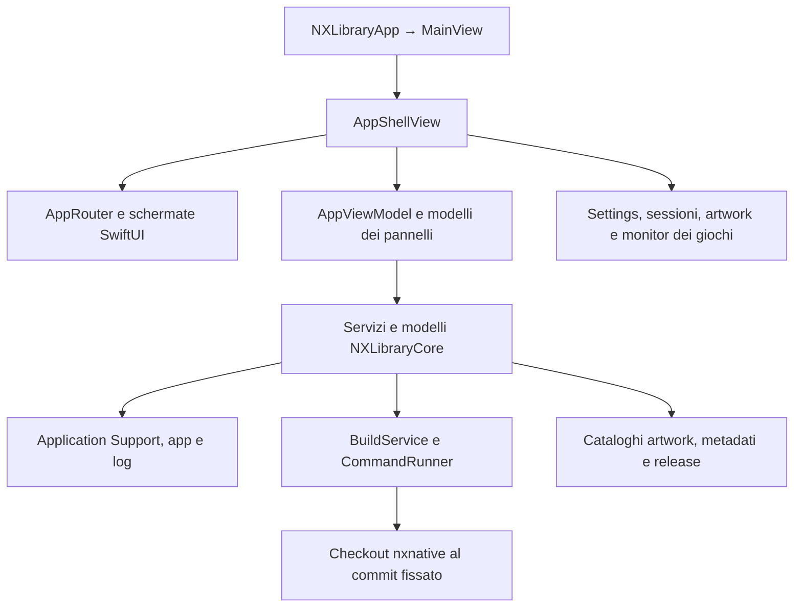

# NX Library — guida tecnica

Aggiornata il 3 novembre 2026 sul codice del repository. La mappa comprende 241 file Swift di produzione e 100 file di test e supporto ai test. Il ramo comprende nxnative b64a5ff0, il canale di aggiornamento, i flussi cartelle/disponibilità e il setup in due passaggi, con 793 test Swift superati. Il maintainer ha confermato l'avvio visibile di Wonder con il nuovo engine; il maintainer ha confermato anche menu, dialogo aggiornamenti, avvio fullscreen, scansione e gate nella candidata UI.

Questa guida descrive il funzionamento attuale. Il [catalogo dei file](file-map.md) assegna una responsabilità a ogni file versionato, suddiviso per area.

Il [README](../README.md) è la guida d'uso; la [guida di sviluppo](development.md) raccoglie build, runtime, CI e release. Il [changelog](../CHANGELOG.md) distingue il lavoro non pubblicato dalle versioni distribuite. Il runtime e i contenuti versionati vengono verificati da `scripts/check_publication.py`; `build_app.sh` installa il bundle completo attraverso `BuildOutputInstaller`, dopo firma e verifica.

## Indice

- [Struttura e dipendenze](#struttura-e-dipendenze)
- [Avvio e stato dell’app](#avvio-e-stato-dellapp)
- [Libreria e navigazione](#libreria-e-navigazione)
- [Setup e compatibilità](#setup-e-compatibilità)
- [Sorgenti e porting](#sorgenti-e-porting)
- [Avvio dei giochi e sessioni](#avvio-dei-giochi-e-sessioni)
- [Cheats](#cheats)
- [Salvataggi, backup e recupero](#salvataggi-backup-e-recupero)
- [Artwork, metadati e sfondi](#artwork-metadati-e-sfondi)
- [Interfaccia Selene e input](#interfaccia-selene-e-input)
- [Dati su disco](#dati-su-disco)
- [Aggiornamenti e distribuzione](#aggiornamenti-e-distribuzione)
- [Verifica e manutenzione](#verifica-e-manutenzione)

## Struttura e dipendenze

[Package.swift](../Package.swift) dichiara tre target. La toolchain Swift è quella di Xcode, con deployment minimo macOS 13.

| Target | Compito |
|---|---|
| `NXLibrary` | Eseguibile SwiftUI, integrazione AppKit, controller, notifiche, coordinamento e rendering. |
| `NXLibraryCore` | Modelli, persistenza, parsing, gestione file, contratti del motore, processi e logica delle funzionalità. |
| `NXLibraryCoreTests` | Test XCTest del Core, con dati sintetici e dipendenze sostituibili. |

`NXLibrary` dipende da `NXLibraryCore`. Il Core usa anche framework macOS, fra cui Combine, AppKit, ImageIO, CommonCrypto e IOKit. Il package attuale usa i framework del sistema e non dichiara dipendenze SwiftPM esterne.



Il checkout nxnative fornisce estrattore, rewriter, shader, profili dei giochi e runtime dei giochi compilati. NX Library prepara gli argomenti, controlla i requisiti e presenta lo stato delle operazioni. Il pin attuale è `b64a5ff09f4dc0f57e9297b6ccaf6f7d95256a44`, definito in `AppViewModel.pinnedEngineCommit`. La cache dello stato upstream viene riutilizzata soltanto quando il suo commit di base coincide con il pin.

## Avvio e stato dell’app

`NXLibraryApp.swift` registra una sola `Window` e i comandi della barra menu. File → Add Game sostituisce New Window: controller, updater e catalogo condiviso non offrono un flusso multi-finestra. `AppDelegate.swift` registra il font Material Icons e gestisce chiusura e riapertura della finestra. `MainView.swift` presenta `AppShellView`.

`AppShellView.swift` possiede gli oggetti condivisi tramite `@StateObject`. Comprendono `AppViewModel`, router, impostazioni, sessioni di gioco, artwork, monitor dei giochi e updater. Imposta palette, canvas Selene, preferenze di accessibilità e livelli sovrapposti. Intro, Setup, menu, ricerca, opzioni di un gioco e conferme ricevono una priorità esplicita nell’input.

`NativeMenuCommands` osserva il tracking dei menu AppKit e rinvia le azioni al turno successivo della coda principale, conservando la sospensione dell’input durante il passaggio. La shell pubblica le disponibilità nella scena attiva tramite `FocusedValues`: intro, Setup, pannelli e assenza di selezione disabilitano i comandi non applicabili. Mouse, monitor tastiera e dispatch controller non cambiano selezione sotto un menu nativo. In Spotlight, Game Details usa `SpotlightState.showGameDetails` come il comando interno e conserva il titolo selezionato; in Collection apre la pagina Details. Game Options blocca l’hit testing del contenuto sottostante.

`startInFullscreen` viene salvato in AppSettings, ha default false per i vecchi file, compare in Search/Changed e viene ripristinato dal reset Start-up. `StartupWindowView` legge il valore alla creazione e applica una sola volta la modalità alla finestra visibile e attiva. Cambiare la preferenza non altera la finestra corrente.


`AppViewModel.swift` coordina libreria, rilevamento dell’ambiente, selezione delle sorgenti, porting e lancio. Le estensioni `AppViewModel+…` contengono le integrazioni di cheats, salvataggi, diagnostica, controlli delle chiavi, toolchain e installazioni in attesa. Sono parti dello stesso oggetto osservabile.

La shell condivide un solo `AppSettingsStore` con router e coordinatore. L’avvio rispetta i flag di verifica del motore e scansione della libreria; senza scansione carica il catalogo salvato. Il primo Setup accompagna l'utente in Get ready e Your games, dove Skip for now completa l'introduzione anche con libreria vuota. La verifica prima di ogni porting resta obbligatoria. I pannelli di build possono avviarla su richiesta. I risultati asincroni relativi a un checkout precedente vengono scartati e il porting registra la propria fotografia della toolchain.

`FirstRunSetup` tiene insieme pagina corrente e completamento: `NXLibrary_SetupPage` permette di riprendere una prima configurazione interrotta, mentre `NXLibrary_SetupCompleted` mantiene compatibili gli utenti già configurati e impedisce ripetizioni automatiche dopo Skip. Open Setup riapre manualmente entrambi i passaggi senza rendere incompleta una configurazione precedente. `YourGamesSetupView` aspetta la scansione prima di distinguere libreria vuota o pronta; Open library e Skip tornano alla libreria. I due passaggi condividono backdrop, indicatore, transizioni e canale di input; Add Game sospende il proprio input quando Setup è davanti.

`SetupCheckModel` e `SavePanelModel` possiedono lo stato dei rispettivi pannelli. `SavePanelModel`, per esempio, mantiene anteprima, operazione in corso, errore, ultimo backup ed evento di importazione riuscita. Gli aggiornamenti destinati alla UI vengono pubblicati sulla coda principale.

## Libreria e navigazione

`PortedGame` rappresenta un titolo della libreria. Include identità, app installata, sorgenti, impostazioni runtime, ultimo porting, toolchain e installazione eventualmente differita. `LibraryFile` è il contenitore persistito in `library.json`.

`GameResourceState` riconcilia app, sorgenti e stato: conserva build in corso e workspace non ancora compilati, distingue app mancante e file di origine mancanti e mantiene Play per una build esistente. Le viste usano `PortingPills.unavailable` per il motivo breve e l'azione primaria disabilitata; `PortingTileLook.locked` riusa sfocatura e lucchetto. La voce rimane in libreria. Non viene aggiunta alcuna ricerca dell'app spostata; Refresh controlla le cartelle già configurate. Un cambio cartella durante la scansione scarta il contesto precedente e avvia quella nuova.

`ImportService` scansiona i bundle `.app`, legge `Info.plist`, riconosce gli identificativi nxnative e produce le voci importabili. La candidata UX aggiunge una visita breadth-first nelle sole cartelle scelte, fino a sei livelli e 4000 directory, con deduplicazione dei percorsi canonici. Non entra in bundle/package e non segue i symlink delle sottocartelle. Limiti e letture fallite producono avvisi con motivo e azione utile: sono visibili accanto a Scan game apps nelle impostazioni e, nel primo Setup, sotto Game apps. Non aprono dialoghi automatici né un ciclo Retry all’avvio e non cancellano il catalogo. Una scansione successiva aggiorna o rimuove gli avvisi. `appsForLibrary` seleziona una sola osservazione per titolo: il percorso già registrato se esiste, altrimenti la prima osservazione del risultato ordinato dalla più recente. Se un'app esiste fuori dall'area scandita, la sua voce resta invariata. Merge e metadati usano la stessa selezione.

`AppSizeCache` ricorda le dimensioni in funzione di percorso e data di modifica. `LibraryStore` carica e salva il catalogo, conserva `library.json.bak` e offre il merge delle voci. Il coordinamento applicativo riconcilia app trovate, dati già salvati e sorgenti disponibili.

La candidata UX integra `FullscreenCursorView` nella shell. Un NSView osserva la propria finestra, il mouse e le transizioni native; `CursorIdleState` decide la visibilità usando il tempo monotono. In fullscreen attivo, con mouse nel contenuto, il puntatore si nasconde dopo tre secondi senza movimento. Cambi di schermata, menu interni, ricerca, opzioni, tastiera/controller, click e scroll non lo rendono visibile. La posizione reale viene campionata anche dal timer: i loop nativi di menu e controlli possono consumare gli eventi prima del monitor locale. Durante un menu nativo si sospende il nuovo nascondimento, senza svelare un puntatore già nascosto; alla chiusura viene riallineato lo stato AppKit. Un movimento riavvia il ritardo. Pannelli di sistema, perdita di focus e uscita fullscreen ripristinano la visibilità. Il distacco rimuove monitor, timer e osservatori e ripristina il precedente `acceptsMouseMovedEvents`. **Il maintainer ha confermato la revisione 2 di scansione e cursore e, nella candidata finale 0.1.2, menu nativi, dialogo aggiornamenti, avvio fullscreen, riga di scansione e gate certificato.**

Il merge parte dalla voce persistita e aggiorna esplicitamente i dati osservati dalla scansione. Conserva impostazioni, identità, preferiti, installazione in attesa ed errore dell’ultimo porting. Restano le regole precedenti per associare le sorgenti e conservare la provenienza di una build installata.

Settings → Library usa un'unica riga **Scan game apps**, con la stessa azione per scoperta e refresh. La riga e l'azione controller sono disabilitate durante la scansione. Il catalogo Search usa lo stesso nome; Collection conserva il proprio ingresso per importare build esistenti.

L’aggiunta o il collegamento esplicito delle sorgenti usa `merge(replacingSources: true)`: la selezione confermata sostituisce sorgenti, workspace e percorso della cache, anche se i file precedenti esistono ancora. I file originali restano sul disco. Le scansioni automatiche continuano a conservare la selezione già registrata e il bundle installato.

### Ambito delle impostazioni

| Punto dell’interfaccia | Autorità |
|---|---|
| Settings → Games → New games | Valori iniziali copiati nei nuovi titoli. |
| Game Options → Next launch | Configurazione di quel titolo, applicata al prossimo avvio. |
| Use new game defaults | Copia una volta i default correnti nel gioco selezionato. |
| Add Game → Review | Nuovo titolo: parte dai default. Titolo esistente: `GameRuntimeConfig.forReview` legge le sue opzioni effettive. La conferma salva i valori mostrati. |
| Cloud saves | Preferenza riapplicata prima di ogni avvio, compreso Off. |
| Controllers | Navigazione della libreria; il sottogruppo New games contiene i default della vibrazione. |

Options e Play leggono `GameRuntimeConfig.load`: preferenze per titolo in UserDefaults, poi `env.txt` del titolo, quello nel bundle e infine i valori del modello. Il rebuild ricava `languageForBuild` dalla configurazione del titolo e non conserva una lingua separata dal wizard. Le modifiche dei default globali non aggiornano automaticamente i giochi già aggiunti. Search e Changed attribuiscono la vibrazione a Controllers.

Il catalogo Settings descrive i singoli controlli; Changed riceve anche le differenze delle preferenze esterne ad AppSettings. Le azioni da controller si aggiornano con lo stato dei pannelli e mantengono il focus per identità. About pubblica azioni selezionabili. Il reset aggiorna AppSettings con una sola assegnazione e segnala le scelte cloud/percorso preservate.

`AppSettingsStore` pubblica gli errori e conserva una copia dei file illeggibili prima di consentirne la sostituzione. La UI usa un dialogo Selene, con Retry per una scrittura fallita. `GameRuntimeConfig.save` propaga gli errori di env.txt e persiste le preferenze per titolo dopo la scrittura riuscita. Un env.txt illeggibile viene conservato e segnalato.

`AppRouter` gestisce schermata corrente, cronologia di ritorno e richieste di selezione. I modelli `SpotlightState`, `LibrarySelectionState`, `DetailsFocus`, `MenuSelectionModel` e `FocusIndex` descrivono il focus indipendentemente dal disegno SwiftUI. `LibraryQuery` applica ricerca, filtri e ordinamento.

Le viste principali sono Spotlight, Collection e Details. Ricerca, Add Game, Console, Game Options e Settings sono raggiunti dalla shell e dalle azioni del router. Le estensioni `…+Input.swift` traducono tastiera, mouse e controller in modifiche ai modelli di focus.

## Setup e compatibilità

`SystemDetector` e `EngineLocation` individuano checkout e cartelle dell’utente. `NXNativeEnvironment` raccoglie lo stato di Python, strumenti, Xcode, Metal e .NET. `EngineToolchain` risolve Python e `PATH`, preferendo il runtime incluso nel bundle quando disponibile.

`SetupProbe` costruisce i dati del Setup. `SetupCheck` li traduce in schede, stati e azioni. `SetupCheckModel` esegue i controlli in background e coordina installazioni e avanzamento. `SetupActions` prepara gli argomenti Git per portare un checkout gestibile al pin. `DotnetRelease` seleziona il pacchetto Microsoft e verifica SHA-512 prima dell’apertura nell’Installer di macOS.

Get ready mostra soltanto i sei requisiti tecnici, in una griglia 3×2; i problemi alle cartelle non riaprono questa schermata. Your games presenta Game apps, la cartella unica in cui cercare giochi nxnative esistenti e installare le prime build. Il default `~/Applications` può essere preparato al primo uso solo se non è già stato scelto o ricordato un percorso. Le destinazioni personalizzate o confermate rimangono ricordate anche quando non disponibili. La lettura basta per scoperta e Play; le nuove installazioni richiedono scrittura. Game files rimane una preferenza facoltativa in Settings → Library, separata dalla selezione temporanea del wizard. Cambiare Game apps non sposta app già registrate; cambiare Game files non sostituisce i sorgenti di un titolo senza conferma esplicita. `GameFoldersCopy` mantiene i nomi coerenti.

`CompatibilityChecker` verifica commit, modifiche del checkout, contratto CLI e compilatore Metal richiesto dal lock del motore. `ToolchainRequirements.current` contiene Xcode minimo, major .NET e asset Metal. `ToolchainGateCopy` produce la spiegazione del risultato per la UI.

Il lock del pin attuale certifica Metal `32023.922`, asset Apple `27B47`, con Xcode minimo `27.2`. La [nota dell’upgrade del 3 novembre](upstream-upgrades/2026-11-03-65501fbb-b64a5ff0-review.md) registra gate certificato senza override, build reale e avvio confermati dall’utente. Un build con override riceve `toolchainVerified=false` e `--allow-other-metal`. Play valuta la disponibilità dell’app già installata separatamente dal gate per un nuovo porting.

Il pin `b64a5ff0` aggiorna audio, allineamento memoria, rendering, shader e profili; aggiunge il controllo chiavi anticipato e la pulizia cache. NUP resta un formato sorgente non esposto dal frontend, i diagnostici non diventano nuovi toggle e i controlli FPS rimangono quelli già supportati. Le precedenti correzioni AV1 restano incluse. Il motore compila dav1d dalle proprie sorgenti incluse; il runtime del frontend non cambia. Gli hook per incorporare la vista del gioco in un frontend non vengono adottati: NX Library avvia app di gioco separate.

## Sorgenti e porting

L'integrazione di [nxnative 163a9905](upstream-upgrades/2026-11-02-2716f78-163a9905-review.md) aggiunge un ingresso per cartelle estratte e metadati per pacchetti con più contenuti. `EnginePackageReader` riusa il lettore content-meta upstream; `ExtractedSourceCatalog` legge NPDM e profili registrati senza chiavi. `SourceSelection` tiene separati contenuti selezionati e file fisici: un pacchetto si conta e si collega una sola volta, il DLC incorporato rimane incluso e la versione scelta viene passata con `-p`.

`GameFileItem` conserva facoltativamente layout e requisito di selezione del titolo; i vecchi JSON continuano a indicare pacchetti. Questi requisiti sono verificati prima del build anche cambiando checkout. Le cartelle estratte sono collegate nel layout `base/`, `updates/<version>/`, `dlc/<title>/0/romfs/`; il restaging rimuove link esclusi e contenitori vuoti, preservando cache e originali. Un pacchetto illeggibile non nasconde gli altri giochi validi: la scansione mantiene i risultati e segnala i file saltati.

Con un engine che riconosce cartelle estratte, Setup permette di proseguire senza chiavi. La selezione di pacchetti cifrati continua a richiederle e a eseguire il preflight. La guida In game include Shift + frecce per la levetta destra delle nuove build. L'integrazione è inclusa nella versione principale al pin riportato sopra.

1. `AddGameView` raccoglie cartelle o file. `SourceCatalog` riconosce NSP, XCI, NSZ e XCZ e raggruppa base, aggiornamenti e DLC. Le selezioni di file vengono scandite e collegate singolarmente, senza includere altri pacchetti della cartella né modificare la preferenza globale Game files. Il reset della bozza avviene solo dopo la conferma del selettore. Più titoli richiedono una scelta esplicita; le riletture dello stesso titolo mantengono nome, impostazioni e selezioni logiche di update/DLC anche se cambiano gli UUID delle righe.
2. `AppViewModel+KeyCheck` invoca `KeyCheck` sulle sorgenti selezionate. Il risultato dipende dalla selezione corrente, così un controllo precedente non abilita un porting diverso.
3. `WorkspaceManager` usa la cartella sorgente in loco oppure prepara un workspace di collegamenti simbolici. Gestisce anche il riuso di una cache esistente.
4. Il coordinatore ricontrolla requisiti, spazio, chiavi e destinazione. `BuildCommandBuilder` produce eseguibile, argomenti, directory di lavoro e ambiente.
5. `BuildService` avvia il processo del motore, gestisce il gruppo di processi, raccoglie stdout e stderr, scrive il log e mantiene l’asserzione contro lo stop per inattività.
6. `BuildEventParser` decodifica il progresso JSON. `PortingProgress` lo aggrega per la UI, con gli shader fino al 90% e le fasi finali nel restante 10%. Il modello alimenta wizard, tile, percentuale e stima del tempo.
7. `BuildOutputInstaller` valida il bundle temporaneo e pubblica il gioco con `renamex_np`: `RENAME_SWAP` scambia atomicamente due app esistenti; `RENAME_EXCL` installa la prima copia senza sovrascrivere una destinazione comparsa nel frattempo. Sullo stesso volume usa direttamente il bundle pronto. Fra volumi diversi prepara prima una copia nascosta accanto alla destinazione, lasciando disponibile l’app corrente fino allo scambio.
8. Se il gioco è aperto o l’installazione è trattenuta da un’operazione sui salvataggi, `PendingInstall` conserva il risultato temporaneo. `AppViewModel+PendingInstall` lo riprende quando può acquisire l’accesso necessario.

`GameAppDestination` centralizza il percorso mostrato nella review, il volume controllato per lo spazio e la destinazione effettiva. Le prime build usano Game apps; un rebuild conserva l'app esistente quando il suo percorso è sicuro, anche dopo un cambio di cartella. I conflitti di nome con app di altri titoli ricevono un percorso distinto. La destinazione viene fissata prima del porting e rimane tale anche nelle installazioni differite. Le installazioni dei giochi richiedono che la cartella esista ancora: se si disconnette o diventa non scrivibile, il risultato pronto viene conservato per Retry. Il packaging del frontend continua a poter creare la propria cartella di installazione.

Se il motore termina correttamente con un bundle valido e fallisce solo l’installazione, `BuildResult.heldApp` conserva la build pronta e `installationFailed` distingue questo caso dal porting fallito. Il coordinatore registra la stessa `PendingInstall` già usata per i giochi aperti. Un dialogo Selene offre Retry e Close: Retry installa quel bundle senza riavviare il motore; Close conserva la build. Gli errori delle installazioni differite passano dallo stesso dialogo. La schermata del porting offre anche Retry installation finché la build resta in attesa. Un errore di scrittura del catalogo conserva lo stato in memoria e impedisce che una scansione immediata lo sostituisca con quello precedente.

Prima della pubblicazione, l’installer registra una piccola ricevuta accanto all’app con percorso di staging e identità filesystem dei bundle. Una ricevuta per destinazione resta dopo il successo e viene aggiornata al prossimo porting: se il processo termina prima del salvataggio del catalogo, il tentativo successivo riconosce l’app già pubblicata e completa il record, anche dopo la pulizia dello staging. Evita così un secondo scambio che rimetterebbe la vecchia app al suo posto. Una destinazione modificata esternamente durante lo stesso tentativo causa un errore conservativo. La vecchia app e l’eventuale sorgente copiata vengono eliminate solo dopo la pubblicazione.

`BuildRecord` conserva l’esito e la provenienza del build. `PortingFailureClassifier` riconosce i messaggi del motore e propone un’azione, presentata da `AppViewModel+Porting`. `PortingNotice` decide se notificare l’esito mentre l’app è in background. `NotificationService` gestisce la notifica di sistema e la destinazione del clic.

Gli adattamenti di b64a5ff0 riconoscono i nuovi errori di chiavi troppo vecchie, conservando la versione firmware quando conosciuta, e il ticket comune mancante nel pacchetto. Quest'ultimo usa il kind persistito `keys` con un dettaglio identificativo: anche un launcher precedente riesce a leggere la voce durante un rollback. La UI corrente offre la spiegazione sul ticket senza proporre di sostituire le chiavi o forzare il porting. Gli eventi `say` della pulizia cache aggiornano `PortingProgress.isCleaningShaderCache`; `PortingETA` mostra **Cleaning shader cache** senza avanzare la percentuale né stimare una durata. Lo stato si azzera su completamento pulizia, stage/step successivo e termine del build.

## Avvio dei giochi e sessioni

Il flusso Play controlla operazioni di salvataggio, recuperi e installazioni in attesa. `GameRuntimeConfig` traduce le impostazioni in variabili `DM_*`. `LauncherSettingsReader` legge il contratto `launcher.json` del gioco e determina i controlli supportati, con fallback per le app più vecchie.

`LaunchService` scrive `env.txt`, conserva le variabili non gestite tramite il merge del modello runtime e avvia il bundle con `NSWorkspace.OpenConfiguration`. Passa anche `DM_LAUNCHER=0`. `CloudSavesPreferences` applica la preferenza cloud al dominio del gioco prima del lancio.

Off rimuove la preferenza cloud salvata dal launcher del gioco anche all’avvio. Gli override avanzati `DM_SAVE_SYNC` nei file o nell’ambiente mantengono la precedenza del motore: `SaveLocation.inspect` ne segnala l’origine e mantiene il blocco delle operazioni incompatibili con la sincronizzazione attiva.

`RunningGameMonitor` confronta i bundle ID della libreria con le applicazioni in esecuzione e offre Resume e Close Game. `LaunchReadinessProbe` attende una finestra visibile del processo per chiudere la schermata di lancio. `PlaySessionStore` registra avvio, heartbeat, fine e riconciliazione delle sessioni. `ActivitySummary` aggrega la settimana, mentre `LibraryPresentation` e `GameDetailPresentation` preparano i valori delle schermate.

## Cheats

`CheatLocator` legge title ID, build ID e percorso secondo il contratto del launcher. `EngineAncestry` e `CheatStatus` determinano se l’app del gioco contiene il supporto ai cheats. `CheatFile` riproduce il parsing dei codici e dei metadati del motore. `CheatInstall` decide se un file appartiene alla build, richiede conferma o va rifiutato.

`CheatStore` legge e modifica file, metadati, master switch e selezione `.enabled`. `AppViewModel+Cheats` espone contesto, stato della riga e informazioni per la diagnostica. `CheatsPanel` presenta lista, importazione, conferme e switch. Il gioco chiuso è una condizione delle modifiche. I file installati vengono poi letti dal motore al lancio.

## Salvataggi, backup e recupero

### Riconoscimento e anteprima

Il flusso usa il title ID e conserva i percorsi interni del salvataggio per ogni gioco. `SaveLocation` ammette l’ID esadecimale di 16 caratteri, risolve il percorso predefinito e legge la configurazione cloud effettiva. `AppViewModel+Saves` verifica anche l’identità nel bundle installato e le preferenze del gioco.

`RyujinxSaveFolder` riconosce `bis/user/save/<indice>`, risale dalle sottocartelle, confronta il title ID in `ExtraData0` e seleziona l’intero albero committed `0`. Le cartelle di esportazione ordinarie mantengono la propria struttura. Il tipo User/Device è una scelta separata dal nome della cartella sorgente.

`SaveSnapshotStore.stageImport` prepara una copia temporanea vicino alla destinazione. L’anteprima contiene inventario, hash SHA-256, attributi estesi e impronta del salvataggio attuale. `SaveRestorePreview.swift` prepara allo stesso modo un ripristino da backup. Alla conferma vengono ricontrollati sorgente, staging e salvataggio attuale.

### Copia protettiva e sostituzione

`SaveTransaction` crea prima un backup verificato dei due slot committed, inclusa l’eventuale assenza di uno slot. Persiste poi il journal `.nxlibrary-save-transaction.json` e sostituisce ciascuna directory con staging sullo stesso volume. Usa `renamex_np(RENAME_SWAP)` per scambiare due directory esistenti e spostamenti per i casi di presenza o assenza.

L’importazione sostituisce lo slot scelto. Il ripristino applica l’intero snapshot, compresa la presenza o assenza dei due slot. `SaveOperationGate` assegna lease per title ID, coordinando salvataggi, Play e installazioni anche quando più voci della libreria condividono lo stesso gioco.

### Integrità e recupero

`SaveFileIO` centralizza copie, hash, metadati, controlli dei percorsi, scritture durevoli e punti di errore sostituibili nei test. La verifica normalizza provenienza e label di accesso gestite da macOS, più il campo agente della quarantena. Confronta i metadati guest e il contenuto dei file. I manifest e i journal precedenti passano dalla stessa normalizzazione.

All’avvio o al refresh, un journal incompleto porta al rollback del salvataggio precedente verificato. Un journal committed richiede la verifica del risultato prima della pulizia. Dati modificati esternamente o copie non verificabili mantengono il recupero bloccato e conservano gli artefatti per l’intervento. Play attende la risoluzione.

`SavesPanel` espone apertura cartella, backup manuale, destinazione, importazione, refresh e cartella backup con data dell’ultima copia. L’anteprima From → To è in `SaveImportDetails`. Dopo ogni importazione riuscita, `SavePanelModel` pubblica un nuovo evento e la vista mostra `SeleneSuccessNotice`, che si chiude dopo tre secondi. Il timer della vista si annulla quando il pannello scompare.

Storage → Save backups apre la cartella comune degli snapshot. Il vecchio export ZIP di Storage è stato rimosso; la creazione delle copie passa dal pannello Saves.

I backup sono copie locali conservate fino alla gestione dell’utente. Sono automatici prima di importazione e ripristino, oppure manuali con Back up now. Importazione e ripristino richiedono sincronizzazione cloud effettivamente disattivata. I casi rifiutati e le verifiche eseguite sono descritti nelle sezioni Saves del README e dei test.

## Artwork, metadati e sfondi

Look distingue Wallpaper e Library screens. Game backgrounds è un controllo positivo: On mostra l’artwork del titolo in Spotlight e Collection, Off mantiene il wallpaper. Riusa la preferenza `keepWallpaperOnGames` invertendo soltanto il binding, senza migrazione dei dati. Details continua a usare l’artwork del gioco; il layout di avvio segue le proprie impostazioni globali. Wallpaper sizing riguarda il wallpaper e Library shade le maschere delle schermate della libreria.

Change artwork conserva la precedenza delle scelte manuali per titolo. La riga di stato ha altezza stabile, testo breve per la ricerca e indicazione della destinazione dell’immagine; segnala Home: wallpaper quando lo sfondo della home è governato dal wallpaper globale.

LaunchBox e SteamGridDB non entrano nella griglia automatica: ciascuno ha un riquadro **Browse online** che apre una griglia propria (`ArtworkBrowseSource`), con ricerca precompilata e modificabile, risultati per lo slot aperto, credito per immagine e X per la pagina del gioco sulla sorgente. La griglia carica solo le anteprime; il file pieno (`ArtworkCandidate.full`) si scarica alla scelta e viene ridimensionato come ogni scelta manuale. LaunchBox non ha API: ricerca e pagina gioco si leggono come TheGamesDB, e immagini e dimensioni vengono dal payload `__NUXT_DATA__`. SteamGridDB usa l’API v2 con la chiave personale dell’utente (file `0600`, mai registrata nei log). Per i giochi senza screenshot Title DB, il caricamento dei metadati (selezione o apertura del gioco) chiede una volta a LaunchBox gli screenshot Gameplay e li conserva 30 giorni (`ScreenshotFallbackStore`); le scansioni della libreria non avviano richieste.

`NintendoStoreMetadataService`, `GameTDBStore`, Title DB e le sorgenti di artwork raccolgono descrizioni, date, generi, copertine, loghi, sfondi e screenshot. `ArtworkNames` confronta i nomi per limitare i candidati al gioco o alle sue edizioni. `ArtworkPicker` e `MetadataOptions` aggregano i risultati per i selettori. `ArtworkPicks` e `MetadataPicks` conservano le scelte manuali.

`ArtworkStore` mantiene la cache immagini. `BoxArtService` risolve le copertine Switch di GameTDB. `GameArtLoader` e `SeleneHeroArt` alimentano sfondo e logo delle schermate con caricamento e cache dedicati.

Per gli sfondi online, i parser dei provider sono in `OnlineBackgrounds.swift`. `OnlineBackgroundService` gestisce rete, progressi, miniature e crediti. `OnlineBrowser` e `OnlineTransfer`, definiti in `OnlineBrowsePanel.swift`, alimentano la griglia e l’importazione nel selettore temi. `ThemeStore` unisce palette, wallpaper inclusi e file importati.

## Interfaccia Selene e input

`SeleneCanvas` scala il canvas 1920×1080 nello spazio disponibile. `SeleneCanvasEnvironment` espone unità e font alle viste. `SeleneTheme` ricava colori e curve di animazione dalla palette. `MaterialIcon` elenca i glifi, mentre `SeleneFonts` registra il font e li rende in SwiftUI.

I componenti condivisi in `Views/Components` disegnano righe, switch, pill, focus, suggerimenti dei tasti, dialoghi e conferme. `SeleneBackdrop` combina gradiente, wallpaper e sfondo animato. `MoonlightRenderer` e `MoonlightShaders` rendono la componente Metal dell’interfaccia. `LiveBackdrop` usa AVFoundation per i video in loop.

`GameControllerService` produce `GamepadAction` e riconosce i simboli dei tasti. La shell assegna l’input al livello attivo. `ButtonPrompts` esclude i segnaposto costituiti soltanto da forme, comprese varianti come `capsule.portrait.fill`, e usa in quel caso i simboli della marca riconosciuta; conserva glifi significativi come `circle.circle` e `square.circle`. `HoldDetector` e i modelli di focus rendono verificabili mapping e navigazione. `SoundEffectService` risolve i cue tramite `SeleneImporter` e applica le impostazioni di volume e attivazione.

La preferenza Riduci movimento unisce l’impostazione dell’app a quella di sistema. Le viste consumano `seleneReduceMotion`, insieme agli altri valori dell’ambiente Selene.

## Dati su disco

I percorsi sono relativi alla home dell’utente. `Application Support/NXLibrary` corrisponde a `~/Library/Application Support/NXLibrary`.

| Percorso | Contenuto e proprietario |
|---|---|
| `Application Support/NXLibrary/library.json` e `.bak` | Catalogo e ultima copia valida, gestiti da `LibraryStore`. |
| `Application Support/NXLibrary/settings.json` | Impostazioni globali, gestite da `AppSettingsStore`. |
| `Application Support/NXLibrary/play-sessions.json` | Sessioni e tempi di gioco, gestiti da `PlaySessionStore`. |
| `Application Support/NXLibrary/keys/prod.keys` | Chiavi importate da `KeyStore`, con permessi `0600`. |
| `Application Support/NXLibrary/app-sizes.json` | Cache dimensioni dei bundle. |
| `Application Support/NXLibrary/workspaces/` | Collegamenti alle sorgenti e workspace per i porting. |
| `Application Support/NXLibrary/artwork/` | Cache immagini, copertine, screenshot e miniature online. |
| `Application Support/NXLibrary/metadata/` | Cache dei metadati dello store. |
| `Application Support/NXLibrary/artwork-picks/` e `metadata-picks.json` | Scelte manuali di immagini e campi. |
| `Application Support/NXLibrary/SeleneImports/` | Suoni, wallpaper, video e relativi crediti importati. |
| `Application Support/NXLibrary/SaveBackups/<TID>/` | Snapshot datati, manifest e copie protettive. |
| `Application Support/NXLibrary/Logs/<TID>.log` | Log di porting costruito dall’app. |
| `~/Library/Application Support/nxnative/<TID>/` | `env.txt`, `save`, eventuale `save_device`, cheats e dati runtime del motore. |
| `~/Library/Logs/nxnative/<TID>.log` | Log del gioco avviato. |
| `<Game apps>/<nome>.app` | Prima installazione del gioco; default `~/Applications`. I rebuild aggiornano l'app nella sua posizione esistente. |
| Accanto al gioco: `.nxlibrary-install-<hash>.json` | Ultima ricevuta di installazione per quel percorso, gestita da `BuildOutputInstaller`. |
| Accanto al gioco: `.nxlibrary-incoming-<hash>.app` | Preparazione temporanea quando il bundle pronto si trova su un altro volume. |
| `UserDefaults` del bundle NX Library | Percorsi ricordati, stato Setup, override toolchain e cache di alcuni controlli. |

Nel repository, `.build/` contiene gli output SwiftPM. `work/Runtime` è il runtime preparato per il packaging, `work/release` contiene i prodotti di release e `dist/` il DMG di sviluppo. Queste cartelle sono escluse da Git. Il catalogo descrive i file versionati separatamente dai dati personali creati durante l’uso.

## Aggiornamenti e distribuzione

Il controllo manuale da menu macOS e About presenta `AppUpdateDialog` sia durante la richiesta sia al suo esito: versione corrente, nuova release con note scorrevoli, errore con Retry o progresso. Il dialogo ha priorità sull’input sottostante; frecce/controller scorrono le note e selezionano le azioni, Escape chiude. La chiusura durante il download lascia il trasferimento in corso. Una richiesta manuale durante un controllo automatico impedisce una successiva seconda offerta automatica per la stessa risposta. Le note mostrano la propria versione anche quando la candidata è più recente dell’ultima release pubblica.

`AppUpdateState` descrive gli stati nel Core. `AppUpdate.mayInstall` impone versione più recente e copia installabile: i controlli manuali di copie di sviluppo o in sola lettura leggono le release, senza autorizzarne la sostituzione. Il gate viene verificato prima del download e prima dell’installazione, insieme ai controlli e ai lease già esistenti. Il motivo di attesa viene passato al dialogo come valore, così la chiusura di un gioco aggiorna il pulsante Update.


`UpstreamChecker` consulta il changelog del motore e `UpstreamCopy` lo presenta. L’adozione di un nuovo commit passa dalla procedura manuale in [AGENTS.md](../AGENTS.md) e dalle [note di upgrade](upstream-upgrades/README.md).

`AppUpdater` coordina gli aggiornamenti di NX Library da `Bium23/NxLibrary`, senza autenticazione. Le regole di versione, requisiti, digest, identità del bundle e installazione sono in `AppUpdate`. Le copie di sviluppo non si sostituiscono. `AppUpdateDownload` limita il trasferimento alla dimensione dichiarata e agli host HTTPS di GitHub. `validate_update.py` verifica struttura e percorsi, poi estrae contando i dati effettivamente decompressi tramite il Python incluso; prima della sostituzione vengono controllati versione, marker, identificativo e firma del bundle. La firma ad hoc protegge il contenuto sigillato ma non identifica autonomamente il manutentore. La prova interattiva A → B resta necessaria.

Prima dell’installazione, l’updater acquisisce un’esclusione globale dal `SaveOperationGate`: aspetta operazioni save/Play/installazioni attive e impedisce nuovi ingressi durante sostituzione e riavvio. Un recupero bloccato senza I/O attivo non impedisce l’aggiornamento. Il coordinatore esclude nuovi porting mentre l’app viene aggiornata.

`bundle_runtime.sh` prepara Python e strumenti da `runtime.lock`, controlla gli hash e sistema i riferimenti Mach-O con `relink_macho.py`. `build_app.sh` compila e confeziona il bundle, risorse, plist e firma ad hoc. Il suo parametro di destinazione permette di preparare una copia temporanea prima della sostituzione della copia installata.

`release.sh` richiede albero pulito e runtime pronto, imposta versione e marker di release e crea ZIP e DMG. `--publish` abilita tag e pubblicazione GitHub con autorizzazione esplicita dell’utente. Il repository contiene anche `build_dmg.sh` per confezionare un bundle già costruito.

## Verifica e manutenzione

`NX_TEST_ENGINE_REPO` permette al controllo dei messaggi del motore di usare un checkout separato; il valore esplicito non valido produce un errore. Durante una revisione, `NX_TEST_ENGINE_COMMIT` seleziona l'hash completo del candidato prima di cambiare il pin dell'app; senza override il test controlla sempre il pin. La suite Core usa fixture sintetiche, directory temporanee, runner e confini I/O sostituibili. Copre modelli, persistenza, sorgenti, chiavi, contratti CLI, processi, installazione, lancio, UI state, artwork, cheats e transazioni dei salvataggi. Il [catalogo dei test](file-map.md#test-e-fixture) indica la responsabilità di ogni file.

```bash
DEVELOPER_DIR=/Applications/Xcode.app/Contents/Developer swift test
bash scripts/build_app.sh
codesign --verify --deep --strict "$HOME/Applications/NXLibrary.app"
```

Le prove interattive dell’app e dei giochi sono eseguite dall’utente. Gli agenti svolgono controlli sul codice, test automatici e build/installazione, secondo `AGENTS.md`.

Per una modifica, partire dall’area nel catalogo, seguire il collegamento al file e leggere i chiamanti reali. Aggiornare la descrizione quando cambia la responsabilità di un file. I piani datati registrano il lavoro svolto, mentre questa guida e il catalogo descrivono l’organizzazione corrente.
