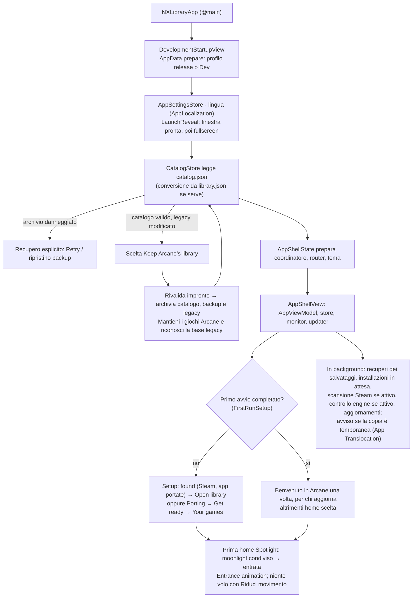
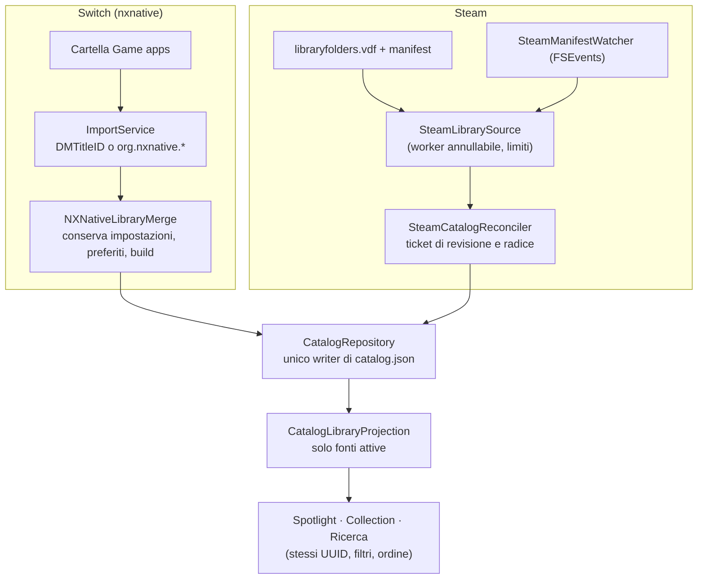
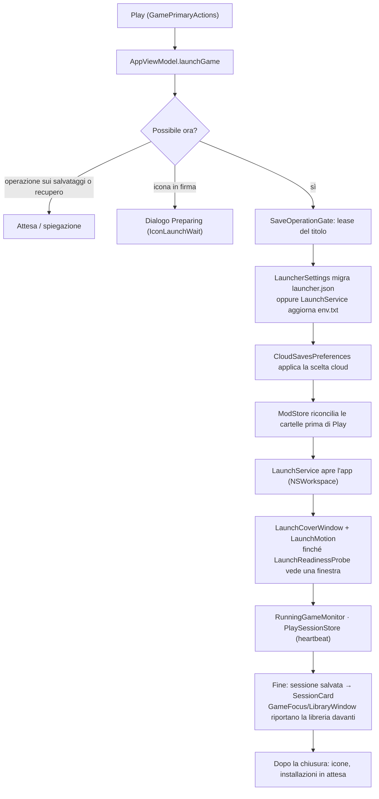
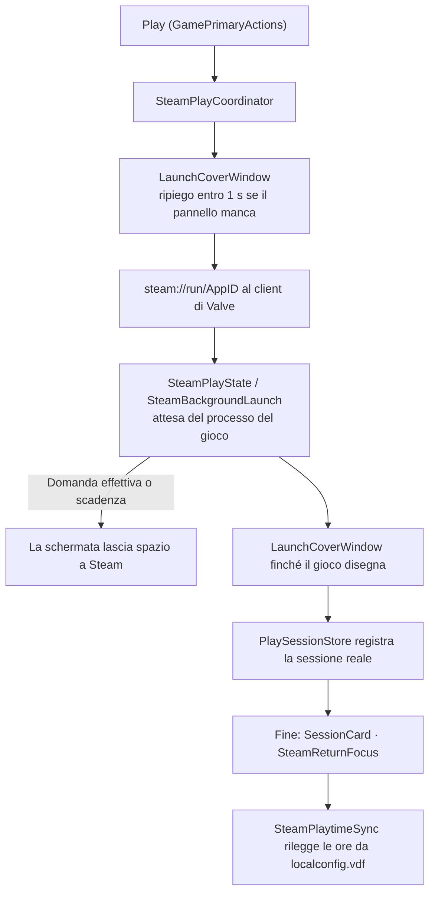
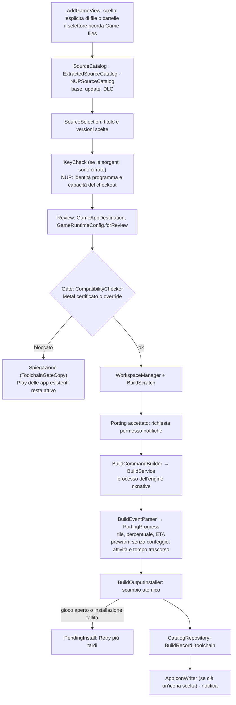
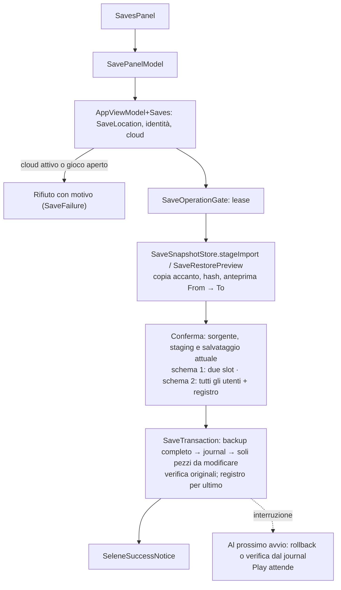
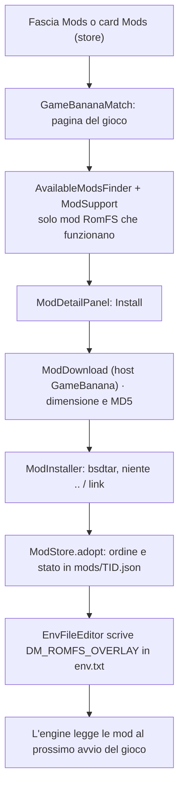
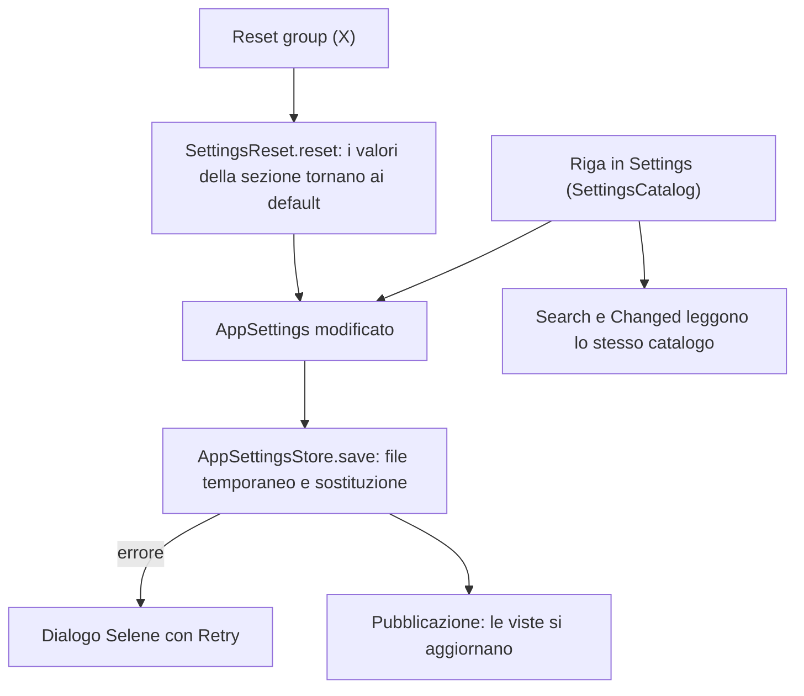
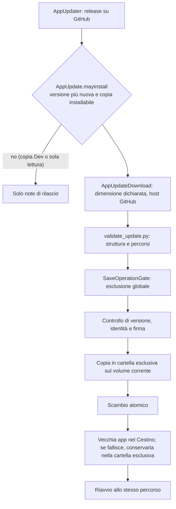

# Arcane — i flussi principali

Ogni flusso segue un'azione dall'input all'effetto, nominando i tipi che se ne occupano. I dettagli e le regole di ogni passo sono nella sezione dell'area in [architecture.md](architecture.md); come costruire un pezzo nuovo è in [conventions.md](../working-on-it/conventions.md). Se un flusso cambia, il suo schema si aggiorna nello stesso commit.

- [1. Avvio dell'app](#1-avvio-dellapp)
- [2. Dal disco alla libreria](#2-dal-disco-alla-libreria)
- [3. Play di un gioco Switch (nxnative)](#3-play-di-un-gioco-switch-nxnative)
- [4. Play di un gioco Steam](#4-play-di-un-gioco-steam)
- [5. Costruire un gioco Switch (Add Game)](#5-costruire-un-gioco-switch-add-game)
- [6. Importare o ripristinare un salvataggio](#6-importare-o-ripristinare-un-salvataggio)
- [7. Installare una mod](#7-installare-una-mod)
- [8. Cambiare un'impostazione](#8-cambiare-unimpostazione)
- [9. Aggiornare l'app](#9-aggiornare-lapp)

## 1. Avvio dell'app

Punti fissi:
- Gli store si costruiscono una volta sola, prima della shell.
- Un archivio illeggibile non diventa mai una libreria vuota.
- La Dev legge e scrive solo nel suo profilo.
- La scelta Steam del primo Setup resta salvata anche alla chiusura; lettura e attivazione usano la cartella scelta nella fonte. Una lettura incompleta offre Retry, senza dichiarare la libreria vuota.
- La cartella Game files ricordata resta una preferenza del selettore: l'avvio non ne enumera i sorgenti.
- Menu e dialoghi nativi hanno precedenza sul routing della shell: `nativeDialogOwnsInput` ferma i comandi del controller anche se un benvenuto, Setup o dialogo dell'app è già aperto sotto.

## 2. Dal disco alla libreria

Punti fissi:
- Una scansione aggiorna solo ciò che ha osservato; un'assenza non cancella nulla.
- Un risultato superato da un cambio di cartella o di fonte non si applica.

## 3. Play di un gioco Switch (nxnative)

## 4. Play di un gioco Steam

Arcane legge le domande dal log di Steam. Durante `ShowInterstitials` l'attesa prosegue e il client può aprire le sue finestre dietro la schermata. Arcane non scrive mai i file di Steam e non apre l'app del gioco direttamente. Dettagli in [steam.md](steam.md).

Nella pagina Spotlight di un titolo Steam, Giù porta anche a **More like this** quando la fascia è presente. Invio, A o doppio clic selezionano la copertina sulla riga della libreria. Se il filtro la esclude, la libreria passa a **All games** come per Switch.

## 5. Costruire un gioco Switch (Add Game)

## 6. Importare o ripristinare un salvataggio

## 7. Installare una mod

## 8. Cambiare un'impostazione

Nel menu rapido, Theme apre prima i colori con anteprima viva; A applica la palette e passa alla selezione dello sfondo. Il tema Arcane conserva il blu classico e l’identità predefinita `selene`; le alternative Arcane Crystal e Arcane Flow salvano `arcane-crystal` e `arcane-flow` nello stesso `colorThemeID`. La shell conserva un backdrop persistente; le pagine ne dichiarano stile, pausa e Mods con `SeleneBackdropRequest`, mantenendo artwork e maschere locali. La shell passa la palette completa in `SeleneBackdropStyle`: cambia il valore dell’ambiente e aggiorna sfondo e maschere anche senza spostare la selezione. La superficie usa lo stesso renderer, con orologio e regole di pausa condivisi. Le particelle sono sempre morbide, senza una scelta aggiuntiva. La scelta dello sfondo mantiene il dialogo di destinazione esistente.

La barra laterale segue `SettingsSidebarGroup`: General, Library, Porting e System. Ogni sezione mostra solo le righe di `SettingsCatalog` che le appartengono.

In System → About, il pulsante Support Arcane compare tra il riepilogo dell’app e i crediti. `SettingsAboutSection` apre la pagina Buy Me a Coffee nel browser predefinito tramite clic, Invio o conferma del controller.

Tornando alla home, le viste delle tessere ricreate leggono subito le immagini decodificate in `TileArtMemo`; i task caricano quelle mancanti e rivalidano i file Steam. La cover della card Mods resta nel `ModStoreHost` posseduto dalla shell ed è rivalidata in background rispetto agli abbinamenti correnti.

## 9. Aggiornare l'app

Alla chiusura successiva, una copia release che si chiama ancora `NX Library.app` diventa `Arcane.app` (`AppBundleRename`, chiamato da `AppDelegate.applicationWillTerminate`). Non succede se un riavvio è in programma, perché l'aiuto che riapre l'app usa il percorso attuale.
